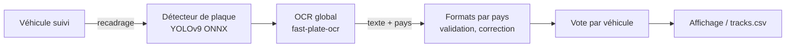

# Plaques d'immatriculation

## Fonctionnement



1. Pour chaque véhicule suivi (voiture, moto, bus, camion) assez grand (`PLATE_MIN_VEHICLE_PX`), sa boîte
   est recadrée.
2. [fast-alpr](https://github.com/ankandrew/fast-alpr) y détecte la plaque puis la lit avec un modèle OCR
   **global** qui prédit aussi le pays.
3. Seule la plaque la plus centrée dans le recadrage est retenue (évite la plaque d'un véhicule voisin).
4. La lecture passe par les [formats par pays](#formats-par-pays) : correction lettre/chiffre selon la position,
   validation, mise en forme.
5. Les lectures d'un même véhicule sont fusionnées par **vote pondéré par la confiance**. Une plaque n'est
   affichée qu'après 2 lectures identiques (ou une lecture très sûre). Après 3 lectures concordantes, l'OCR
   s'arrête pour ce véhicule ; après des échecs répétés, les tentatives s'espacent.

## Pays reconnus

Le modèle `cct-s-v2-global-model` couvre une soixantaine de pays, dont **la France**, la plupart des pays
européens (Belgique, Suisse, Allemagne, Espagne, Italie, Royaume-Uni, Pays-Bas, Pologne…), le Canada, le
Brésil, l'Argentine, le Mexique, l'Australie… La liste exacte est dans
`~/.cache/fast-plate-ocr/cct-s-v2-global-model/*_plate_config.yaml` (`plate_regions`).

!!! note "États-Unis"
    Les plaques américaines sont lues, mais le pays est souvent prédit comme « Canada » : le modèle ne
    semble pas avoir de classe dédiée aux États-Unis.

Modèles alternatifs (`PLATE_OCR_MODEL`) : `cct-xs-v2-global-model` (plus rapide),
`european-plates-mobile-vit-v2-model`, `global-plates-mobile-vit-v2-model`, `argentinian-plates-cnn-model`.

## Formats par pays

`projets/distance_vitesse/plate_formats.py` contient la syntaxe officielle de chaque pays pris en charge :

| Pays | Format | Exemple affiché |
|---|---|---|
| France — SIV (depuis 2009) | `AA-123-AA`, sans I, O, U ; jamais `SS` en tête ni `000` | `AB-123-CD` |
| France — FNI (avant 2009) | `1234 AB 75`, `123 ABC 75`, `123 AB 75`, `12 ABC 75` | `1234 AB 75` |
| Monaco | 4 caractères | `A123` |
| Belgique | `1-ABC-123` | `1-ABC-123` |
| Espagne | `1234 BCD` | `1234 BCD` |
| Italie | `AB 123 CD` | `AB 123 CD` |
| Royaume-Uni | `AB12 CDE` | `AB12 CDE` |

Corrections appliquées selon la position :

- dans une position « chiffre » : `O`, `Q`, `D` → `0` ; `I`, `L` → `1` ; `Z` → `2` ; `S` → `5` ; `B` → `8`…
- dans une position « lettre » : `0` → `O`, `8` → `B`, `5` → `S`… puis, pour le SIV, les lettres interdites
  sont remplacées par la plus proche visuellement (`O` → `D`, `I` → `T`, `U` → `V`).

Quand l'OCR ne prédit aucun pays, les formats de `PLATE_COUNTRIES` (France par défaut) sont essayés. Un pays
prédit mais sans format défini (ex. République tchèque) est conservé tel quel, sans correction.

!!! info "Limites connues pour la France"
    - Les départements corses `2A` / `2B` (FNI) ne sont pas encore gérés.
    - Les plaques de collection (`FNI` noires), diplomatiques (`CD`, `CMD`) et `W garage` ne sont pas reconnues.

## Ajouter un pays

### 1. Un format (5 minutes)

Si l'OCR lit déjà correctement les caractères mais que vous voulez valider et mettre en forme :

```python
# projets/distance_vitesse/plate_formats.py
FORMATS["Germany"] = [
    # Simplifié : 1-3 lettres (ville), 1-2 lettres, 1-4 chiffres -> longueur variable,
    # donc un gabarit par longueur.
    PlateFormat("Allemagne", "LLLDDD", r"[A-Z]{2}[A-Z]\d{3}", (2, 1, 3), " "),
    PlateFormat("Allemagne", "LLLLDDDD", r"[A-Z]{2}[A-Z]{2}\d{4}", (2, 2, 4), " "),
]
```

- La clé est le nom renvoyé par l'OCR (`plate_regions` du modèle, en anglais).
- `template` : `L` lettre, `D` chiffre, `X` l'un ou l'autre, une lettre par caractère.
- `pattern` : expression régulière finale sur le texte sans séparateurs.
- `groups` + `separator` : mise en forme.
- Ajoutez des cas de test dans `tests/` (voir [Contribuer](../projet/contribuer.md)).

### 2. Un modèle OCR spécialisé (pays mal lu)

Si les caractères eux-mêmes sont mal lus (alphabet particulier, plaques sur deux lignes…) :

1. Constituer un jeu de données : recadrages de plaques + texte (quelques milliers d'images ; les recadrages
   peuvent être extraits automatiquement par Traffic Vision puis corrigés à la main).
2. Entraîner ou affiner un modèle avec [fast-plate-ocr](https://github.com/ankandrew/fast-plate-ocr)
   (`fast-plate-ocr train …`, voir sa documentation), à partir d'un modèle global.
3. L'exporter en ONNX et l'utiliser via `PLATE_OCR_MODEL` (modèle du hub) ou un chemin local
   (`ocr_model_path` / `ocr_config_path` de fast-alpr, à exposer dans `.env`).

### 3. Un détecteur de plaques spécialisé

Pour des plaques de forme inhabituelle (motos, plaques carrées), entraînez un détecteur YOLO sur
un jeu de données de plaques puis passez-le à fast-alpr (`detector=`).

## Conseils de prise de vue

Voir [Matériel → Caméras](../guide/materiel.md#cameras) : au moins 100 px de largeur de plaque, obturation
rapide, faible compression, infrarouge la nuit.

!!! danger "Données personnelles"
    Une plaque d'immatriculation est une donnée personnelle. Lisez [Conformité](../projet/conformite.md)
    avant tout usage sur la voie publique.
