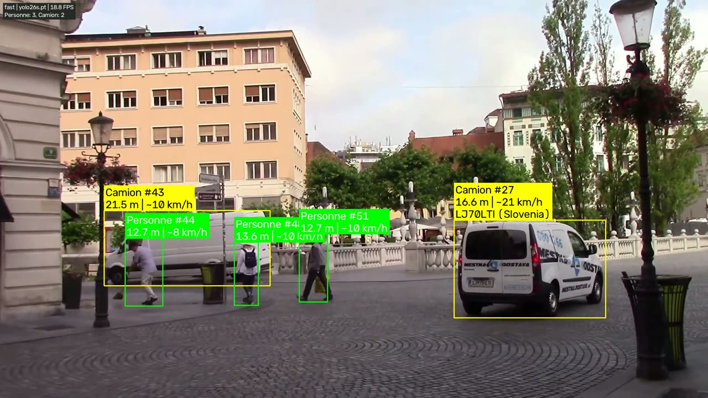
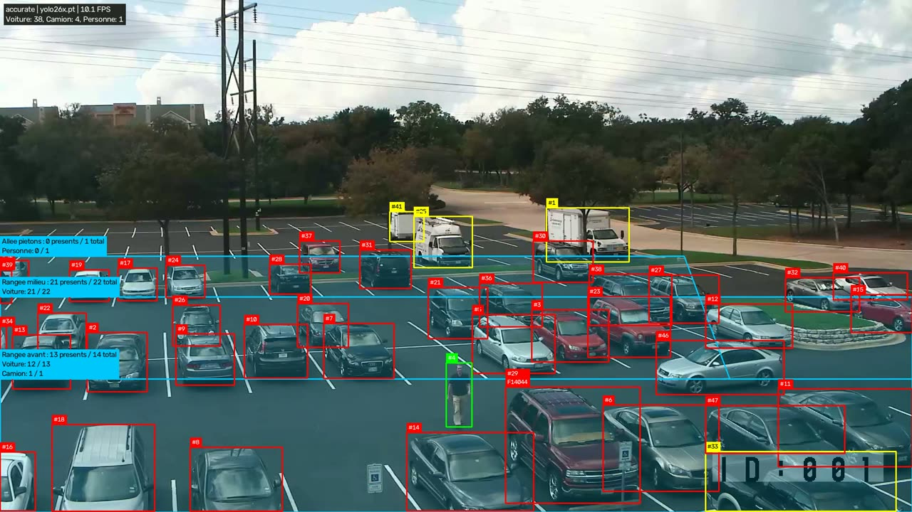
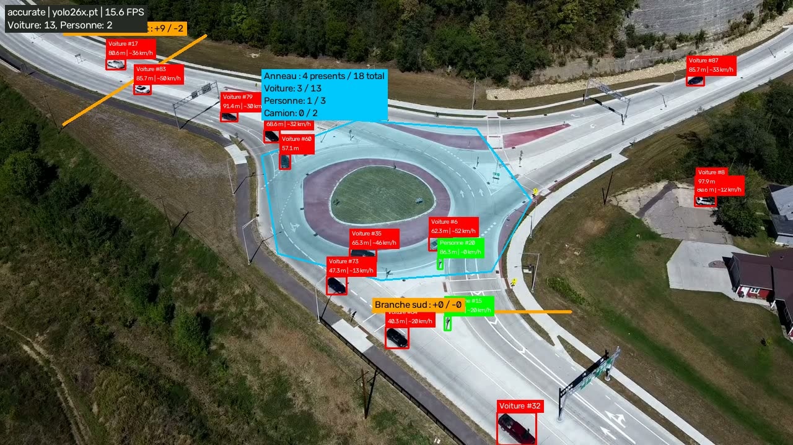
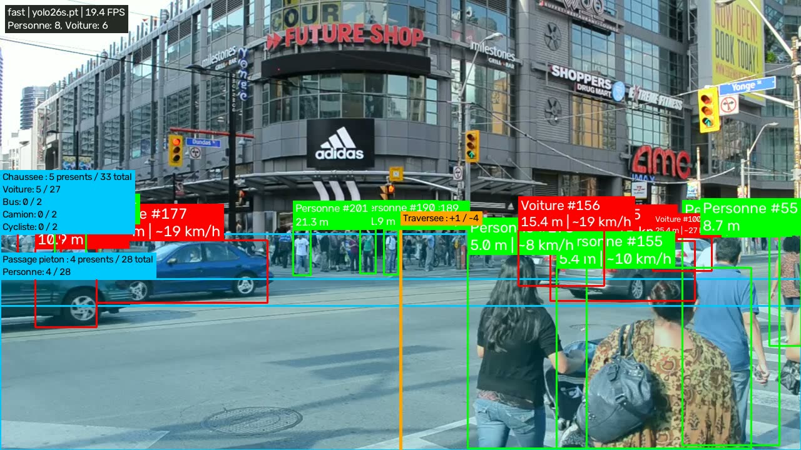

# Traffic Vision

**Traffic Vision** analyse un flux vidéo (caméra CCTV, webcam, vidéo enregistrée ou image) avec
[YOLO26](https://docs.ultralytics.com/models/yolo26/) pour détecter, suivre et mesurer ce qui se passe dans la scène.



!!! info "Statut : preuve de concept"
    Le projet est un laboratoire de vision par ordinateur. Les mesures sont des **estimations** :
    lisez [Distance et vitesse](fonctionnalites/mesures.md) avant d'en tirer des conclusions.

## Fonctionnalités

| | Fonctionnalité | Détails |
|---|---|---|
| :material-eye: | **Détection et suivi** | YOLO26 + ByteTrack / BoT-SORT : chaque objet garde un identifiant stable |
| :material-paw: | **Classes étendues** | Personnes, véhicules, animaux (chien, chat, cheval…) ; vocabulaire ouvert avec YOLOE |
| :material-bicycle: | **Cyclistes et motards** | Une personne sur un vélo/une moto devient un seul objet (pas de double comptage) |
| :material-ruler: | **Distance** | Modèle sténopé à partir de la hauteur réelle de l'objet et du champ de vision |
| :material-speedometer: | **Vitesse** | Estimée en continu ; précise avec une calibration du sol (homographie) |
| :material-card-text: | **Plaques** | Lecture multi-pays (fast-alpr) ; formats français SIV et FNI validés et corrigés |
| :material-vector-polygon: | **Zones et lignes** | Occupation, total d'entrées et franchissements par sens |
| :material-speedometer-medium: | **Deux modes** | `fast` pour le temps réel, `accurate` pour les vidéos enregistrées |
| :material-docker: | **Docker** | Image GPU + flux annoté consultable dans le navigateur |
| :material-file-chart: | **Rapports** | Vidéo annotée, CSV par objet, journal d'événements, résumé JSON |

## En 30 secondes

```bash
pip install torch torchvision --index-url https://download.pytorch.org/whl/cu128
pip install -r requirements.txt
python scripts/download_samples.py
python -m vision_lab distance_vitesse samples/videos/parking_cctv.mp4 --mode accurate --zones zones/parking_cctv.json
```

Suite : [Démarrage rapide](guide/demarrage.md).

## Aperçu

<div class="grid" markdown>







</div>
