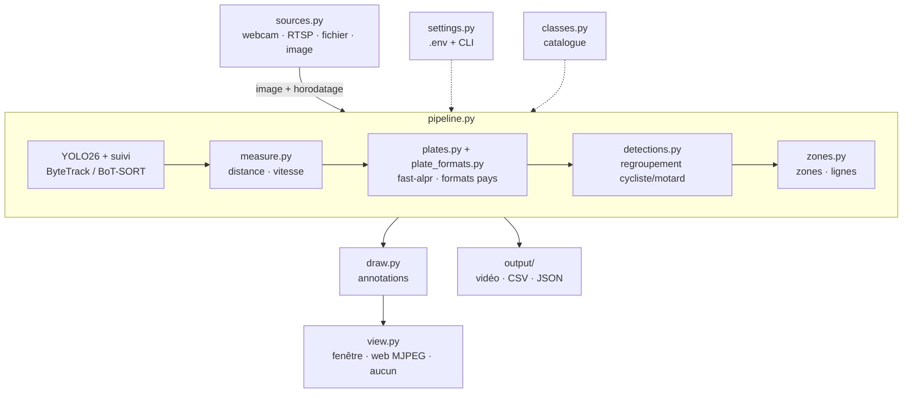

# Architecture

## Flux de traitement



## Modules

| Module | Rôle |
|---|---|
| `__main__.py` | Ligne de commande, chargement des certificats système |
| `settings.py` | Lecture du `.env`, préréglages `fast` / `accurate` |
| `classes.py` | Catalogue des classes (libellé, hauteur réelle, couleur, catégorie) ; parsing du vocabulaire ouvert |
| `sources.py` | Ouverture des sources ; lecture en thread avec abandon des images en retard pour le live |
| `pipeline.py` | Orchestration : inférence, mesures, plaques, regroupement, zones, rendu, rapports |
| `detections.py` | Structure `Detection` ; regroupement personne + vélo/moto |
| `measure.py` | Focale, distance, homographie du sol, estimateur de vitesse |
| `plates.py` | Lecture des plaques par véhicule suivi (cadence, vote, arrêt après confirmation) |
| `plate_formats.py` | Formats de plaques par pays : correction, validation, mise en forme |
| `zones.py` | Zones (occupation, entrées) et lignes (franchissements orientés) |
| `draw.py` | Dessin des boîtes, étiquettes, zones, bandeau d'information |
| `view.py` | Affichage : fenêtre OpenCV, serveur MJPEG, ou rien |
| `zone_editor.py` | Éditeur interactif de zones |

## Choix techniques

- **Suivi intégré à Ultralytics** (`model.track(persist=True)`) : un identifiant stable par objet est la
  base de la vitesse, du vote des plaques, du regroupement et du comptage.
- **Horodatage** : pour un fichier, `index / FPS` (la vitesse est juste même si le calcul est lent) ; pour
  un flux live, l'horloge réelle.
- **Plaques sur CPU** par défaut : modèles ONNX minuscules, et pas de conflit entre la version CUDA attendue
  par `onnxruntime-gpu` et celle de PyTorch.
- **Hauteur plutôt que largeur** pour la distance (indépendante de l'orientation).
- **Pas d'état global** : tout passe par `Settings` et `Pipeline`, ce qui permet de lancer plusieurs
  pipelines (plusieurs caméras) dans un même processus.

## Tests

```bash
pip install pytest
python -m pytest
```

Les tests (`tests/`) couvrent la logique pure : formats de plaques, distance, vitesse, homographie,
regroupement cycliste, zones et lignes. Ils ne nécessitent ni GPU ni modèle.
